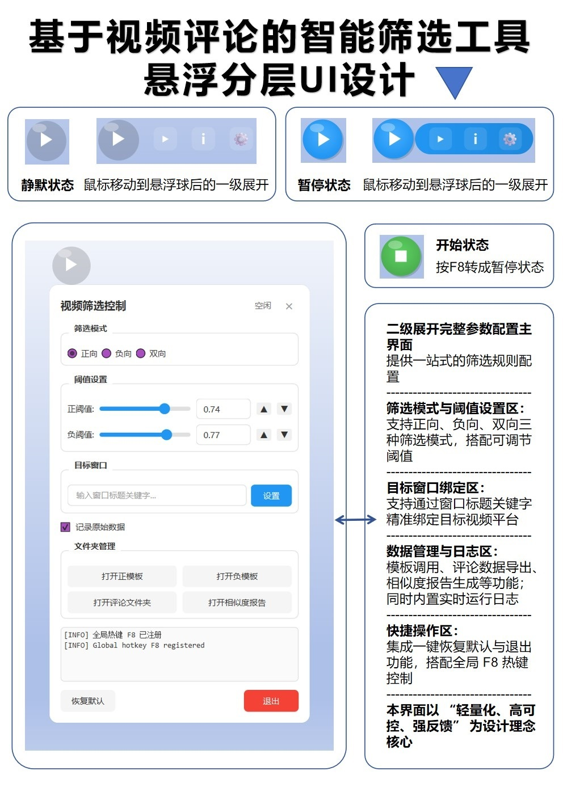

# 基于 MiniLM 的短视频个性化智能筛选系统

一款面向短视频运营场景的 Windows 桌面端 AI 助手：悬浮球一键启动，自动抓取视频评论，用**离线语义模型**按你的意图精准筛选，把人工数小时的工作压缩到分钟级。

全程本地推理，**无任何网络请求，数据不出设备**。

> **想直接运行**：双击 `bin\QtFloatingBall.exe` 即可（该目录已含 exe、Qt 运行时、模型与配置）。
>
> **从源码构建**：见[构建](#构建)。`model.onnx`（448MB）不随仓库分发，见 [`models/README.md`](models/README.md)。

## 界面

悬浮球分层交互：闲置时以不同颜色的悬浮球表示运行状态，鼠标悬停展开一级快捷面板，再呼出二级完整参数面板。



二级面板集成筛选模式切换、正负阈值滑轨、目标窗口绑定、模板与数据管理、实时运行日志。整体以"轻量化、高可控、强反馈"为原则，最大程度减少对视频画面的遮挡。

---

## 目录

- [界面](#界面)
- [核心功能](#核心功能)
- [系统架构](#系统架构)
- [技术栈](#技术栈)
- [目录结构](#目录结构)
- [构建](#构建)
- [运行准备](#运行准备)
- [技术亮点](#技术亮点)
- [文档](#文档)

---

## 核心功能

1. **评论一键抓取** —— 绑定目标窗口，自动抓取并解析短视频评论区
2. **语义级筛选** —— 不是关键词匹配，而是理解"这条评论在说什么"
3. **阈值可视化调节** —— 滑轨实时调整正/负向筛选尺度，黑盒 AI 变可控决策
4. **悬浮球交互** —— 拖拽、悬停展开面板、`F8` 全局热键，不遮挡视频画面
5. **完全离线** —— ONNX Runtime 本地推理，无联网、无云端调用

### 筛选决策逻辑

负向模板优先级最高，命中即停止（`FilterEngine` / `SimilarityPolicy::Evaluate`）：

```
                 ┌─ 负向模板命中 ─────────────────────────────→ 停止（过滤掉）
评论 ─→ 编码 ─→ ┤
                 └─ 负向未命中 ─→ 正向模板命中? ─ 是 ─→ 停止（过滤掉）
                                                └ 否 ─→ 滚动（保留）
```

支持三种模式（位掩码，见 `data/config.json` 的 `mode`）：仅正向 `1`、仅负向 `2`、双向 `3`。

---

## 系统架构

采用**严格分层 + 静态库解耦**，UI 与核心算法物理隔离：

```
┌──────────────────────────────────────┐
│  UI 表现层（Qt 悬浮球）               │  不包含任何算法/推理逻辑
│  main_videofiltering.cpp             │
│  VideoFilteringWidget.cpp/h          │
└──────────────────┬───────────────────┘
                   │ 仅依赖抽象接口
┌──────────────────▼───────────────────┐
│  IApplicationController（纯虚接口）    │
└──────────────────┬───────────────────┘
                   │ 实现
┌──────────────────▼───────────────────┐
│  核心引擎层 VideoFilteringCore.lib    │  独立静态库，无 Qt 依赖
│  ├─ ApplicationService（业务编排）     │
│  ├─ StateManager      （状态）         │
│  ├─ ConfigurationManager（配置）       │
│  ├─ FilterEngine      （筛选调度）     │
│  ├─ SimilarityPolicy  （多实例匹配）   │
│  └─ OnnxInferencer    （语义推理）     │
└──────────────────┬───────────────────┘
                   │
        ONNX Runtime · SentencePiece · nlohmann_json
```

依赖方向单向无环：`UI → 接口 → 核心库 → 第三方静态库`。

核心算法被编译为静态库 `VideoFilteringCore.lib`，UI 层**看不到**任何推理细节，只通过 `IApplicationController` 调用。

详见 [`docs/ARCHITECTURE.md`](docs/ARCHITECTURE.md)：模块职责、接口契约、筛选执行流程、决策矩阵与线程模型。

---

## 技术栈

| 项 | 选型 |
|---|---|
| 语言 | C++17 |
| UI | Qt 6.11（Core / Gui / Widgets） |
| 推理引擎 | ONNX Runtime 1.14.1（CPU，本地离线） |
| 语义模型 | 多语言 MiniLM-L12-H384（384 维 / 12 层 / 117.5M 参数 / 250k 词表），配 XLM-R SentencePiece 分词 |
| 其他依赖 | SentencePiece 0.2.1、nlohmann_json |
| 平台 | Windows x64 |
| 构建 | Visual Studio 2022/2026（.vcxproj/.sln）或 CMake |

---

## 目录结构

本仓库把「可运行成品 / 源码 / 文档 / 工具」放在同一个目录下，克隆后一处即可看全貌。

```
.
├── bin/                            # ★ 可直接双击运行的成品（本地生成，不入库）
│   ├── QtFloatingBall.exe
│   ├── Qt6Core/Gui/Widgets.dll     # Qt 运行时
│   ├── onnxruntime.dll (+providers_shared)
│   ├── platforms/qwindows.dll
│   ├── models/                     # model.onnx + sentencepiece.bpe.model
│   └── data/                       # config.json + 语义模板
│
├── CMakeLists.txt                  # CMake 构建脚本
├── QtFloatingBall.sln              # Visual Studio 解决方案（主构建入口）
├── QtFloatingBall.vcxproj          # UI 表现层工程
├── main_videofiltering.cpp         # 程序入口
├── VideoFilteringWidget.cpp/.h     # 悬浮球主窗口
│
├── VideoFilteringCore/             # 核心引擎层（静态库，无 Qt 依赖）
│   ├── VideoFilteringCore.vcxproj
│   ├── application/                # 接口 + 业务编排 + 配置 + 状态 + 调度
│   ├── core/                       # 多实例语义匹配策略
│   ├── clean/                      # 评论文本清洗与解析
│   ├── model/                      # ONNX 推理 + SentencePiece 分词（含 offset 补偿）
│   ├── utils/                      # 剪贴板/文件/输入/日志/数学工具
│   ├── include/                    # 第三方头文件 + sentencepiece.lib
│   ├── nlohmann/                   # json.hpp
│   └── onnx/                       # ONNX Runtime SDK（头文件 + 导入库 + DLL）
│
├── data/                           # 源码侧的配置与模板样例
│
├── models/                         # 分词表与模型相关材料
│   ├── sentencepiece.bpe.model     # 上游原版分词表（随仓库）
│   ├── tokenizer.json              # 原始分词器参照（重建分词表要用）
│   ├── finetune/                   # 微调用 PyTorch 权重 + config（本地，不入库）
│   └── README.md
│
├── docs/                           # 文档与可视化
│   ├── ARCHITECTURE.md             # 说明：架构、接口契约、执行流程
│   ├── ENGINEERING_LOG.md          # 复盘：时间线
│   ├── TOKENIZER_ALIGNMENT.md      # 复盘：分词偏移事故完整调查
│   ├── LESSONS.md                  # 复盘：可迁移教训 + 自检清单
│   ├── legacy-architecture.txt     # 历史：早期的架构笔记
│   ├── images/ui-design.jpg        # 可视化：UI 设计图
│   └── html/                       # 可视化：Doxygen 类层次图/依赖图（本地生成）
│
└── tools/                          # 辅助工具
    ├── rebuild_sentencepiece_model.py
    ├── spm_probe.cpp
    └── CMakeLists.txt
```

> `bin/`、`models/finetune/`、`docs/html/`、`build*/` 均为本地生成物，已在 `.gitignore` 中排除。

---

## 构建

### 环境要求

- Windows 10/11 x64
- Visual Studio 2022 或更高（含 C++ 桌面开发工作负载）
- Qt 6.11 MSVC 2022 64-bit

### 方式一：Visual Studio（推荐）

1. 用 VS 打开 `QtFloatingBall.sln`
2. 选择 `Release | x64`
3. 生成解决方案

工程内所有路径均使用 `$(ProjectDir)` 相对路径，克隆到任意目录均可编译。第三方库（ONNX Runtime、SentencePiece）随仓库提供，**无需额外安装**。

> 需要安装 VS 的 Qt 扩展（Qt VS Tools），因为 `VideoFilteringWidget.h` 依赖 `moc` 生成。若未安装，请改用方式二。

### 方式二：CMake

```bash
cmake -S . -B build -DCMAKE_PREFIX_PATH="C:/Qt/6.11.0/msvc2022_64"
cmake --build build --config Release
```

CMake 使用 `AUTOMOC` 自动处理 Qt 元对象，不依赖 VS 扩展。

---

## 运行

### 方式一：直接运行（最简单）

```
双击 bin\QtFloatingBall.exe
```

`bin/` 已包含全部运行所需：exe、Qt 运行时、ONNX Runtime、`models/`、`data/`。
启动后按 `F8` 唤出悬浮球。

### 方式二：从源码构建后部署

1. 构建（见上一节），产物位于 `build\Release\` 或 `x64\Release\`
2. 按 [`models/README.md`](models/README.md) 准备 `model.onnx` 与分词表
3. 把 exe 放到一个目录下，同级放好 `models/`、`data/`，并补齐运行时：

   ```bash
   # Qt 运行时
   C:\Qt\6.11.0\msvc2022_64\bin\windeployqt.exe QtFloatingBall.exe
   # ONNX Runtime（构建后会自动复制，若手动部署则拷这两个）
   copy onnxruntime.dll onnxruntime_providers_shared.dll <目标目录>
   ```

   现成的 `bin/` 就是这样组装出来的，可直接参照其结构。

---

## 技术亮点

**1. 语义原型向量匹配**

借鉴多实例学习（MIL）思路：把一组正/负例评论经均值池化抽象为一个"语义原型向量"，筛选时只需算一次余弦相似度即可判定，而非逐条比对。配合批量推理，单次筛选在百毫秒级。

> 说明：这是**工程方案**，不是算法层面的新颖性贡献——原型向量取的是模板内各条评论嵌入的算术均值，判别依据是余弦相似度与阈值比较。相关逻辑见 `VideoFilteringCore/core/similarity_policy.cpp`。

**2. 全离线本地推理**

ONNX Runtime 直接加载本地模型，全程无网络调用。相比 Python 原生推理，首次加载速度提升约 8 倍，内存占用降至约四分之一。

**3. UI 与内核物理隔离**

核心算法编译为无 Qt 依赖的静态库，UI 层只透过 `IApplicationController` 单向调用。可移植、可测试、可替换 UI。

**4. 人机协同透明决策**

阈值滑轨实时生效，配置自动持久化（`data/config.json`），AI 判定不再黑盒。

**5. 无干扰轻量化交互**

悬浮球分层设计（一级快捷面板 / 二级完整设置），双窗口绑定，最大程度减少对视频画面的遮挡。

---

## 文档

| 文档 | 内容 |
|---|---|
| [`docs/LESSONS.md`](docs/LESSONS.md) | 经验教训库：七次转折点的完整记录 + 9 条可迁移教训 + 自检清单 |
| [`docs/ENGINEERING_LOG.md`](docs/ENGINEERING_LOG.md) | 工程日志：时间线、关键决策、踩过的坑与修复 |
| [`docs/ARCHITECTURE.md`](docs/ARCHITECTURE.md) | 分层架构、模块职责、接口契约、执行流程、决策矩阵 |
| [`docs/TOKENIZER_ALIGNMENT.md`](docs/TOKENIZER_ALIGNMENT.md) | 故障复盘：分词器与模型 ID 空间错位（静默正确性缺陷的定位与修复方案） |
| [`models/README.md`](models/README.md) | 模型获取与张量接口要求 |
| [`data/README.md`](data/README.md) | 配置字段与模板格式 |

### 生成 API 文档

```bash
doxygen Doxyfile
```

输出到 `docs/html/index.html`（约 700 个文件 / 4 MB，只覆盖本项目自有源码，含类层次图与依赖图）。

该目录**不纳入版本库**——生成物应能随时从源码重建，否则难免出现"文档比代码陈旧"的情况。

---

## 实现分工与 AI 使用说明

本项目为 3 人团队作品。以下说明本人的工作范围，便于评估与核对。

**本人负责**

- **系统架构**：UI 表现层与核心引擎层的分层方案、`VideoFilteringCore` 静态库的边界划定、`IApplicationController` 纯虚接口定义、依赖方向约束
- **技术选型**：多语言 MiniLM（384 维）搭配 XLM-R SentencePiece 词表，ONNX Runtime 本地离线推理，Qt 6 悬浮球交互
- **交互设计**：悬浮球两级分层交互、阈值滑轨、全局热键 `F8`、目标窗口绑定流程
- **三方集成与调试**：Qt 6 / ONNX Runtime / SentencePiece 的编译、链接与运行时打通
- **问题定位与修复**：见下表

**代码产出方式**

架构、模块划分、接口与交互逻辑由本人确定；具体函数实现使用 AI 辅助生成初稿，再由本人逐块验证、调试与修正。仓库中部分文件保留了生成来源注释（如 `// AI辅助生成：DeepSeek-R1, 2026-4-22`），未作删改。

**本人定位并修复的典型问题**

| 现象 | 根因 | 修法 |
|---|---|---|
| 分词器在含中文的路径下加载失败 | SentencePiece `Load()` 接收窄字符路径，Windows 下按 ANSI 码页解析 | 宽字符读取原始字节 + `LoadFromSerializedProto()` |
| 中文源码编译报 C4819 / C2001 | 源文件为 UTF-8 无 BOM，MSVC 默认按 936 码页解析 | 为相关 target 显式加入 `/utf-8` |
| 换机器或换目录后无法编译 | 源码与工程文件中硬编码了本机绝对路径 | 统一改为 `$(ProjectDir)` 相对路径 + 按 exe 目录动态解析 |
| 运行期找不到 `onnxruntime.dll` | 工程未配置构建后复制步骤 | CMake 与 vcxproj 均增加 post-build 复制 |

---

## 许可

MIT License，详见 [`LICENSE`](LICENSE)。

第三方组件遵循各自许可：ONNX Runtime（MIT）、SentencePiece（Apache-2.0）、nlohmann_json（MIT）、Qt（LGPL-3.0）。
